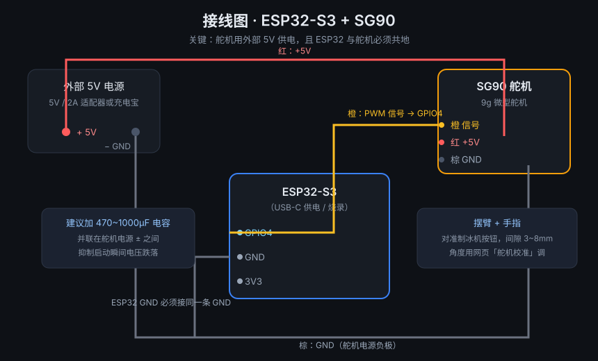

# 制冰机手指机器人 · Ice Finger Bot

用 ESP32-S3 驱动 SG90 舵机，做一个"手指"去按制冰机（或任何带实体按钮的设备）的开关。
支持**网页控制**、**定时任务**、**微信小程序**、**小爱同学语音**、**远程控制**。

> 面向的场景：制冰机这类设备只有一个实体按键，没有联网功能。
> 舵机按一下 = 切换一次状态，等价于你亲自去按。

```
   你说"打开制冰机" / 点小程序          ┌────────────────┐
   ────────────────────────────────►  │  云端（可选）   │
                                       └───────┬────────┘
                                               │
   ┌───────────┐   HTTP/定时    ┌─────────────▼─────────────┐
   │  ESP32-S3 │◄──────────────►│  WiFi                     │
   │           │                └───────────────────────────┘
   │  PWM ─────┼──► SG90 舵机 ──► 手指 ──► 制冰机按钮
   └───────────┘
```

---

## 目录

- [它能做什么](#它能做什么)
- [硬件清单](#1-硬件清单)
- [接线](#2-接线五分钟)
- [三步上手](#3-三步上手)
- [三种控制方式](#4-三种控制方式)
- [远程控制方案](#5-远程控制方案选一个)
- [串口命令速查](#6-串口命令速查)
- [HTTP API](#7-http-api速查)
- [项目结构](#8-项目结构)
- [常见问题](#9-常见问题)
- [已知限制](#10-已知限制)
- [许可](#许可)

---

## 它能做什么

| 能力 | 说明 |
|---|---|
| 🔘 **按一下** | 舵机带动手指按下按钮，等价于手动按一次 |
| 🕐 **定时任务** | 最多 16 条，按星期或单次，本地 RTC + NTP 对时，断网也执行 |
| 📱 **网页控制** | 设备自己开热点/联网后提供网页，手机浏览器直接操作、校准角度 |
| 💬 **微信小程序** | 局域网直连，或走巴法云远程；可查看状态、开关、改定时 |
| 🗣️ **小爱同学** | 通过巴法云接入米家，"小爱同学，打开制冰机" |
| ☁️ **远程** | 自建服务器（VPS）/ 微信云开发 / 巴法云直连，三选一 |
| 🔋 **低功耗** | 静止 5 秒停 PWM、WiFi 深休眠、CPU 80MHz，待机约 40~60mA |

> ⚠️ **重要前提**：本项目没有物理反馈。制冰机按钮是"按一下切换"，固件只能记录
> "逻辑状态"。如果有人手动按过机器、或机器自己停了，逻辑状态会和现实不一致。
> 解决方法：用 `state on|off`（串口）或网页上的「机器实际是开/关」按钮**同步一次**。
> 想要彻底闭环，需要加电流检测（见 [已知限制](#10-已知限制)）。

---

## 1. 硬件清单

| 物料 | 规格 | 参考价 | 说明 |
|---|---|---|---|
| 主控 | **ESP32-S3** 开发板 | 20~40 元 | 4MB Flash 即可；C3 也支持（改 `-e` 环境） |
| 舵机 | **SG90** 9g 微型舵机 | 5~10 元 | 180°，扭矩够按按钮 |
| 电源 | 5V/2A 适配器 或 充电宝 | 10~20 元 | **舵机必须外部供电** |
| 电容 | 470~1000µF 电解电容 | 1 元 | 并联在舵机电源上，防复位 |
| 支架 | 3D 打印 / 硬纸板 + 热熔胶 | 0~10 元 | 把舵机固定在按钮旁边 |
| 线材 | 杜邦线若干 | 5 元 | |
| （可选）电流互感器 | SCT-013 / ACS712 | 10~20 元 | 做状态闭环，见已知限制 |

---

## 2. 接线（五分钟）



| SG90 线 | 颜色 | 接到 |
|---|---|---|
| 信号 Signal | 橙（或黄） | **ESP32 GPIO4** |
| 电源 VCC | 红 | **外部 5V 电源 +**（⚠️ 不要接 3.3V） |
| 地 GND | 棕（或黑） | **外部 5V 电源 −** ，同时接 **ESP32 GND** |

**三条硬规矩**：

1. 舵机电源**必须外部 5V**——用开发板 5V 引脚带舵机，一受力就电压跌落、ESP32 复位；
2. **必须共地**——舵机电源的负极要和 ESP32 的 GND 连在一起，否则信号没有参考电平；
3. 舵机电源正负极之间**并一颗 470~1000µF 电容**，能明显减少偶发重启。

更详细的接线说明、为什么选 GPIO4、怎么装手指：[docs/wiring.md](docs/wiring.md)

---

## 3. 三步上手

### 第 1 步：烧录固件（5 分钟）

```bash
# 安装 PlatformIO（VS Code 插件或命令行都行）
pip install platformio

cd firmware
pio run -t upload            # 默认环境 = ESP32-S3
```

> **板子烧完不启动？**（串口只反复打印 `ESP-ROM`）
> 多半是 Flash 模式不对。打开 `firmware/platformio.ini`，把这两行取消注释再烧：
> ```ini
> board_upload.flash_mode = dout
> board_upload.flash_freq = 40m
> ```
> 另外确认 `flash_size = 4MB`（8MB 的板子要改成 8MB，否则启动失败）。

### 第 2 步：配网（1 分钟）

1. 上电后设备开热点 **`IceFingerBot`**，密码 **`icebot1234`**
2. 手机连它 → 浏览器打开 **http://192.168.4.1**
3. 填家里 WiFi（**2.4GHz**）→ 保存 → 设备自动重启并联网

联网后可以用 **`http://icebot.local`** 或路由器里看到的 IP 访问。

> 想省掉这一步：把 WiFi 写进固件。复制 `firmware/platformio.local.example.ini`
> 为 `platformio.local.ini`，填好 SSID/密码，用 `-c platformio.local.ini -e s3-verify` 烧录。

### 第 3 步：校准角度（2 分钟）

打开网页 → **舵机校准**：

1. 拖「抬起角度」直到手指**刚好不碰**按钮
2. 拖「压下角度」直到按钮**被按到底**（听到"咔"）
3. 点「试按一次」验证，能按动就保存

角度和按住时长会存进 Flash，断电不丢。

---

## 4. 三种控制方式

### 4.1 网页（最全）

设备 IP 直接打开，功能：

- 按一下 / 设为开机 / 设为关机 / **同步实际状态**（开关反了用它纠正）
- 舵机校准（滑块 + ±1°/±5° 微调 + 实时跟随）
- 定时任务（16 条，按星期或单次）
- WiFi 设置、静态 IP、省电模式、语音（巴法云）配置
- 实时状态：角度、信号强度、内存、运行时间、日志

### 4.2 微信小程序

- **局域网模式**：手机连同一 WiFi，功能对齐网页
- **巴法云模式**：出门也能用（开关 + 云端定时）

小程序配置、域名白名单、代码结构：[docs/miniprogram-bemfa.md](docs/miniprogram-bemfa.md)

### 4.3 小爱同学（语音）

走巴法云「云云对接」，米家自动同步成开关设备：

```
小爱同学，打开制冰机
小爱同学，关闭制冰机
```

步骤（10 分钟）：
1. 注册 <https://cloud.bemfa.com>，建主题 `bingji006`（**006 = 开关类型**）
2. 串口执行 `voice tcp <私钥> bingji006`
3. 米家 App → 我的 → 其他平台设备 → 添加 → 巴法 → 登录巴法账号
4. 设备会自动出现，改名叫「制冰机」

详见 [docs/voice.md](docs/voice.md)

---

## 5. 远程控制方案（选一个）

| 方案 | 成本 | 需要 | 适合 |
|---|---|---|---|
| **巴法云直连**（推荐） | 免费 | 巴法账号 + 小程序加域名白名单 | 个人/家庭，最省事 |
| 微信云开发 | 免费额度 | 开通云环境 | 不想买域名，也不介意用腾讯云 |
| 自建服务器 | ~15 元/月 | 国内轻量云 + **备案域名** | 想完全掌控、以后做多设备 |

三者设备端协议一致，随时可换：

- 巴法云：[docs/miniprogram-bemfa.md](docs/miniprogram-bemfa.md)
- 微信云开发：[docs/cloud.md](docs/cloud.md)
- 自建服务器：[docs/server.md](docs/server.md)（带一键部署脚本）

---

## 6. 串口命令速查

连上串口（115200）后输入 `help` 看全部。常用：

```
status              设备状态
press               按一下
on / off            确保开机 / 关机（已是对应状态则跳过）
state on|off        同步实际状态（只改记录，不按按钮）★ 开关反了用这个
rest 25             抬起角度
down 75             压下角度
hold 450            按住时长(ms)
wifi SSID PASS      配网
ip static 192.168.1.50 255.255.255.0 192.168.1.1 192.168.1.1
power on            省电模式（WiFi 休眠 + 舵机空闲断电 + 关热点）
cpu 80              降频到 80MHz
voice tcp UID TOPIC 接入巴法云（语音控制）
ap on               临时打开配网热点
task                查看定时任务
reboot / reset      重启 / 恢复出厂
```

完整列表：[docs/serial-cli.md](docs/serial-cli.md)

---

## 7. HTTP API（速查）

| 方法 | 路径 | 说明 |
|---|---|---|
| GET | `/api/status` | 状态 |
| GET | `/api/config` | 配置（不含密码） |
| POST | `/api/config` | 修改配置 |
| GET | `/api/tasks` | 定时任务列表 |
| POST | `/api/tasks` | 覆盖保存任务 |
| POST | `/api/action` | `{"action":"press"/"on"/"off"/"angle"/"setstate"}` |
| GET | `/api/logs` | 运行日志 |

完整字段：[docs/api.md](docs/api.md)

---

## 8. 项目结构

```
ice-finger-bot/
├── firmware/              ESP32 固件（PlatformIO + Arduino）
│   ├── src/main.cpp       主程序：舵机状态机、WiFi、Web、定时、云、语音
│   ├── src/web_ui.h       内嵌网页（HTML/CSS/JS 全部在固件里）
│   ├── platformio.ini     构建配置（默认 S3，含 C3 备选）
│   └── test/ap_probe/     最小 AP 测试固件（排查板子问题用）
├── miniprogram/           微信小程序
│   ├── pages/             控制 / 定时 / 设置 / 云
│   └── utils/             接口封装（局域网 + 巴法云双模式）
├── server/                自建云中转（Node 零依赖 + 一键部署）
├── web/index.html         网页版控制面板（独立文件版）
├── tools/                 自检与联调脚本
└── docs/                  文档
```

---

## 9. 常见问题

| 现象 | 处理 |
|---|---|
| 烧完不启动，串口只有 `ESP-ROM` 循环 | Flash 模式改成 DOUT（见第 3 步）；确认 flash_size |
| 舵机不动，网页能开 | 信号线没接 GPIO4 / 舵机没供电 / 没共地 |
| 按一下就重启 | 舵机抢电 → 外部 5V + 电容 |
| 舵机抖或嗡嗡响 | 角度顶死了，把压下角度调小 |
| 手机搜不到 `IceFingerBot` | 板子天线问题（某些 C3 小板没接天线）；用 `firmware/test/ap_probe` 确认 |
| 定时不准 | 设备没联网就没法 NTP 对时，网页可手动「用浏览器时间对时」 |
| **开关反了** | 用 `state on/off` 或网页「机器实际是开/关」同步一次 |
| 说"打开"没反应 | 检查 `voice` 状态是否 MQTT/TCP 已连接；米家里设备是否在线 |

---

## 10. 已知限制

1. **没有物理反馈**：靠逻辑状态判断，手动按过机器会漂移。→ 加电流检测可根治。
2. **单设备单用户**：没有账号体系；远程靠共享令牌，适合家庭自用，不适合公开发布。
3. **不支持 OTA**：当前分区表只有一份 app（1.3MB）；要 OTA 需换分区表。
4. **小程序远程需备案域名**（走巴法云则不需要自己备案）。
5. **2.4GHz WiFi**：ESP32 不支持 5GHz。

---

## 许可

MIT License，见 [LICENSE](LICENSE)。

> 注意：`firmware/platformio.local.ini` 含 WiFi 密码，已列入 `.gitignore`，
> 提交前请确认没有被 `git add -f` 强制加入。
